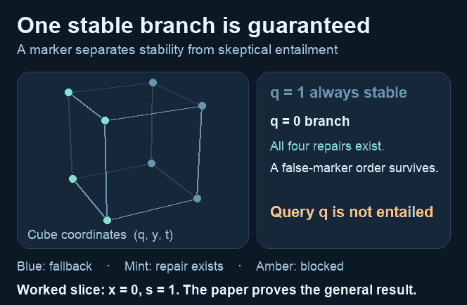

# Skeptical inference from strongly stable source integrations

Deciding whether every maxcon of every strongly stable source tripartition entails a query is **$\Pi_3^{\mathrm P}$-complete**. Hardness persists for a literal query even when there is a known strongly stable tripartition. The inference reduction uses the same quantified-Boolean gadget as the companion Q621 existence proof. [Liberatore’s question](https://doi.org/10.1613/jair.1.11238) · [Companion Q621](https://doi.org/10.5281/zenodo.24572371)

[Paper PDF](paper/manuscript.pdf) · [LaTeX source](paper/manuscript.tex) · [Catalog Q622](https://github.com/10m-u/open-problems-catalog/blob/ca8d4d44ba3db527f19f28928c240168f545ecfe/problems/computer_science_ai/theory-of-computation-algorithms-part-1.md#q622)

## One stable branch is guaranteed

The guard $q\lor f$ replaces each old formula $f$. When the $q$ marker is reliable, all guarded formulas can be accepted together. When $\neg q$ is reliable, the old maxcon comparisons return. If that branch has a stable tripartition, it gives an integration that falsifies $q$.

[Download the offline explorer ZIP](https://raw.githubusercontent.com/DannyExperiments/skeptical-inference-stable-source-integrations/v1.0.0/visualization/skeptical-inference-stable-source-integrations-explorer.zip) · [Worked example and rendering guide](visualization/README.md)

## Scope and evidence

The hardness instances have disjoint sources of at most three individually satisfiable formulas. All three tiers can be required nonempty. The ordinary language uses vacuous truth if there is no strongly stable tripartition. The marker construction proves the same hardness without relying on that convention. [Exact scope](CLAIM_SCOPE_AND_LIMITATIONS.md) · [Literature audit](audits/public_safe_reports/LITERATURE_AUDIT.md)

[Finite replay](REPRODUCIBILITY.md) checks small quantified matrices, source rankings, and the guarded projection. The analytic manuscript proves the general result. Internally reviewed, not peer reviewed. [Review status](STATUS.md) · [Technical disclosure](AI_DISCLOSURE.md)

DannyExperiments is the preferred citation identity. [Release v1.0.0](https://github.com/DannyExperiments/skeptical-inference-stable-source-integrations/releases/tag/v1.0.0) · [Version DOI](https://doi.org/10.5281/zenodo.24572374) · [Citation metadata](CITATION.cff)
