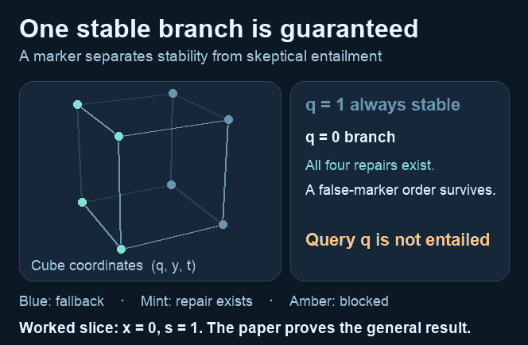

# One stable branch is guaranteed

[Download the offline explorer ZIP](https://raw.githubusercontent.com/DannyExperiments/skeptical-inference-stable-source-integrations/v1.0.0/visualization/skeptical-inference-stable-source-integrations-explorer.zip). Extract it and open the HTML locally. Switch between the two matrices and rotate the cube.

The cube displays $(q,y,t)$. Fix $x=0$ and the added outer bit $s=1$. For $\Phi_0=y\lor z$ every pair $(y,t)$ admits a repair in the padded matrix $\Phi=\Phi_0\lor(s\land t)$. For $\Phi_0=y$, the pair $(0,0)$ admits none. In the latter case that pair also blocks all other outer choices. The $q=1$ branch always supplies one stable tripartition, independent of the displayed universal bits.

Each $q=1$ cube corner represents a choice of the universal bits in the same fallback branch. Mint or amber corners at $q=0$ show repair availability in the worked slice. The [paper](../paper/manuscript.pdf) treats all choices and proves the reduction.

Render the GIF using an existing Python environment with Pillow and Arial or DejaVu Sans.

~~~sh
python3 visualization/render.py
~~~
